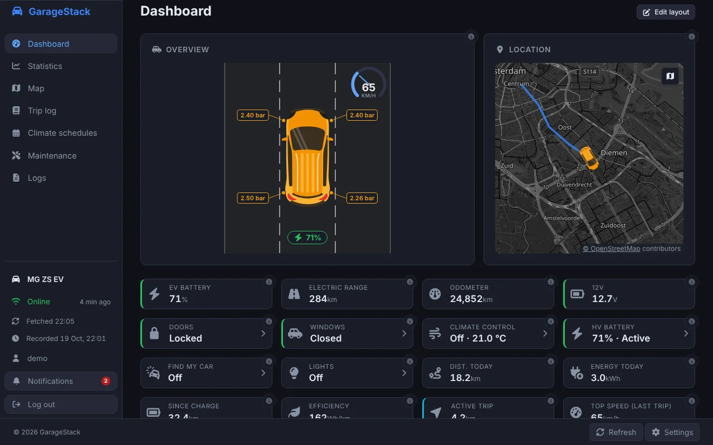
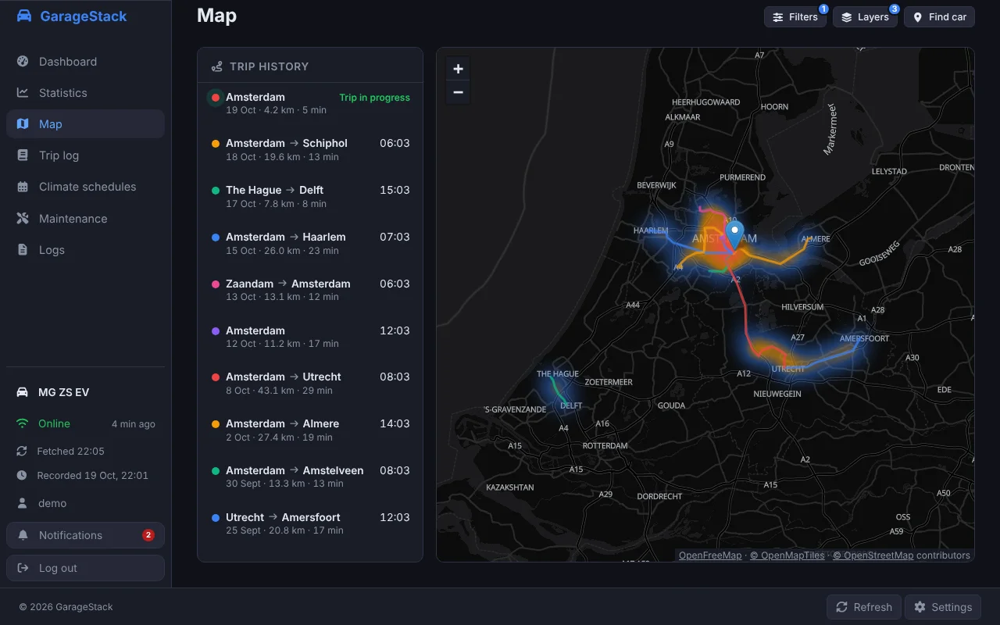
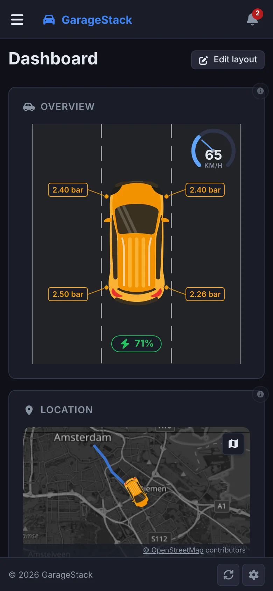
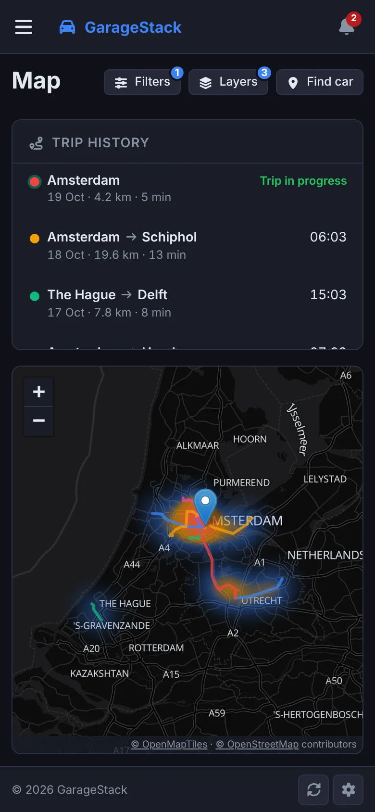
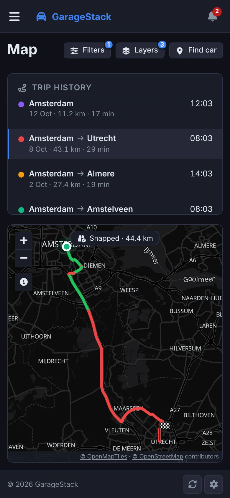

# GarageStack

**A self-hosted dashboard, trip log and map for your MG.**

[](https://github.com/joszz/GarageStack/releases/latest)
[](https://github.com/joszz/GarageStack/actions/workflows/docker-publish.yml)
[](LICENSE)



GarageStack is a free, open-source web app for **modern MG cars**, the ones built by SAIC Motor such as the MG4, MG5, ZS EV and HS PHEV. It signs in to the SAIC iSmart API, the same backend the official MG iSmart app uses, and turns what your car reports into something worth opening:

- **See the car at a glance.** Fuel, battery, tyre pressures, doors, windows and climate on one live dashboard, with cards that adapt to your hybrid, plug-in hybrid or full electric car.
- **Relive every drive.** Trips are saved automatically, named by where they went and drawn on the map along the roads you took, with heatmaps and the speed limits along the way.
- **Keep a trip log for the taxman.** Mark trips as business, commute or private, add notes, and export a month or a year as a spreadsheet.
- **Control it from anywhere.** Pre-condition the cabin, lock the car or flash its lights to find it, and see whether the car actually carried the command out.
- **Have it warm when you leave.** Schedule climate for weekday mornings or a one-off trip, with seat heating, the defrosters, and a skip for mild days.
- **Hear about it when something is off.** Push notifications for low tyre pressure, a car left unlocked, a window left open, charging complete and more.
- **Fit it into your homelab.** Home Assistant through MQTT discovery, a gethomepage.dev widget, and single sign-on through Authentik, Authelia, Keycloak or any other OpenID Connect provider.
- **Keep it yours.** Everything runs in Docker on your own hardware, as one all-in-one container or a Compose stack. No subscription, and no account needed beyond your MG login.

> **Note:** GarageStack only works with the current MG brand owned by SAIC Motor. It is **not** compatible with classic British-built MG cars (MGB, Midget, MGF, etc.) produced before SAIC's acquisition of the brand. If your car does not use the MG iSmart app, GarageStack will not work with it.

## Screenshots

Every trip on one map, listed by where it went and drawn along the roads you took, over a heatmap of the roads you drive most:



And on a phone, with a single trip snapped to the roads and coloured against the speed limits:

<!-- markdownlint-disable MD033 -->

| Dashboard | Map | A single trip |
| --------- | --- | ------------- |
|  |  |  |

<!-- markdownlint-enable MD033 -->

The statistics, trip log, maintenance list and light theme are in the [screenshot gallery](documentation/screenshots/README.md).

**Want to try it?** Read [MG iSmart account and session limits](#mg-ismart-account-and-session-limits) first, because GarageStack and the MG app cannot be signed in to the same account at once, then pick an [installation option](#installation). A single `docker run` is enough to get going.

## Features

- **Live dashboard** -- Real-time vehicle telemetry displayed as configurable cards. Cards are automatically shown or hidden based on your vehicle type (HEV, PHEV, BEV) and can be reordered or toggled individually in the dashboard's edit mode. The car drawn on the dashboard takes your car's colour (Settings > Car colour), and the vehicle type can be set by hand under Settings > Vehicle type when detection gets it wrong.
- **Tyre history** -- Tap a tyre's pressure on the dashboard's car to see a month of daily pressures for all four tyres, and how each one moved against the other three over the last two weeks: a tyre falling behind the others while they hold is a slow puncture, which also sends a notification.
- **Trip history** -- Browse past journeys on an interactive map, each drawn on the roads it took and coloured by speed or by the speed limit, with a heatmap of the roads you drive most. Each trip is saved to the database a few minutes after the car parks. After upgrading from a version that did not save trips, the existing history is saved in the background on the Worker's first start.
- **Trip log** -- Mark each trip as business, commute or private (commutes between your home and work are marked automatically), add notes, and export a month or a year as a spreadsheet with the addresses and odometer readings a tax trip log (such as the Dutch *rittenregistratie*) asks for. See [Trip log](#trip-log).
- **Maintenance** -- Keep the car's service items (oil, tyres, the yearly inspection, ...) with a distance interval, a time interval or both. GarageStack works out from the odometer and your service log when each one is due, shows the most urgent on the dashboard, and sends a notification when an item reaches 90 % of its interval. Log each service with its date, odometer reading and notes.
- **Energy statistics** -- Track daily energy consumption, efficiency (Wh/km on a plug-in car, L/100 km on a hybrid), fuel use, electric share, average driving speed, and more, for any period from a week to several years.
- **Remote commands** -- Trigger climate pre-conditioning (normal climate, fan only or front defrost), lock or unlock the car, open the boot, and activate the horn and lights remotely from the dashboard. On a plug-in car also start or stop charging, lock or unlock the charging cable, switch battery heating on or off, set the charging and battery heating schedules, and set the charge current limit and, where the car takes one, the charge target. Opening the boot and unlocking the cable ask for a second tap. Each command reports whether the car carried it out, and if it refused, the reason the MG servers gave.
- **Climate schedules** -- Switch climate on at a set time on chosen weekdays, or once. A schedule sets the temperature or mode, seat heating and the rear defroster, and can skip mild days by the car's outside temperature. Schedules run on the server, so no browser needs to be open, and each run sends a push notification saying whether the car started climate.
- **Push notifications** -- Browser and in-app alerts for key events: engine started, low or high tyre pressure, a slow puncture, low EV battery, low fuel, a weak 12V battery, car left unlocked, doors or windows left open, the car moving while parked, a charge that finished or stopped early, maintenance coming due, a climate schedule that ran, the messages the official MG app receives, and data that stopped arriving because the MG sign-in failed or the car went quiet. Each device chooses which ones it gets.
- **Homepage widget** -- A read-only API endpoint for the [gethomepage.dev](https://gethomepage.dev) Custom API widget, exposing key vehicle stats at a glance.
- **Log viewer** -- The Logs page shows the entries of the API's and the Worker's log files, newest first and older ones loading as you scroll, filtered by service, level and text, with exceptions folded open on request and a live mode that adds what was written every ten seconds. The files themselves stay on the server, one per day (`LOG_RETAINED_FILES`).
- **Full data export** -- Settings > Your data downloads everything GarageStack keeps as one zip: per car its trips, maintenance, schedules, places and every telemetry reading (as CSV), and your notifications and settings.
- **Read-only API tokens** -- Make a token under Settings > API tokens and let a script, a dashboard or a watch read what the app shows, without signing in. A token can only read: it cannot send commands or change anything, and the full data export and the logs stay with a signed-in session.
- **Home Assistant** -- Your car appears in Home Assistant automatically through MQTT discovery, sharing GarageStack's broker and MG session instead of needing a second integration. See [`HOME_ASSISTANT.md`](documentation/HOME_ASSISTANT.md).
- **Progressive Web App (PWA)** -- Installable on mobile or desktop for a native app-like experience, complete with a home screen icon and push notification support. Where the browser allows it, GarageStack offers to install itself, and the offer can be turned down for good. Installing and push need HTTPS, see [HTTPS](#https).
- **Charging stations** -- Overlay nearby EV charging stations on the map, sourced from the [Open Charge Map](https://openchargemap.org) database. Station data is cached in the database for 7 days; on page load the map immediately shows all stations within 100 km of your car that are already cached. Markers show operational status; clicking a marker displays the station name, operator, address, and available connector types with power ratings. Requires a free OCM API key (`OPENCHARGEMAP_API_KEY`). Unlike fuel stations and service areas, charging station tiles are loaded on demand as you browse the map and are not pre-populated by the background Worker.
- **Fuel stations** -- Overlay nearby petrol and diesel stations on the map (HEV and PHEV only; not shown for BEV). Sourced from OpenStreetMap via the Overpass API -- no API key required. POI data is cached in the database for 7 days and pre-populated by the Worker for a 100 km radius around the car's last known position so the overlay is instant on first view.
- **Motorway service areas** -- Overlay motorway service areas and rest stops on the map (all vehicle types). Same DB-backed cache and Worker pre-cache as fuel stations; useful for BEV drivers who often find fast chargers at service areas.
- **Speed cameras** -- Overlay the speed cameras mapped in OpenStreetMap (`highway=speed_camera`), with the limit each one enforces and the kind of camera it is where OSM records them. Same DB-backed cache and Worker pre-cache as fuel stations, off until you switch it on in the map's layer panel, and removable from the deployment with `SPEEDCAMERAS__ENABLED=false` -- see the note on jurisdictions in the Map overlays section.
- **Place names** -- Trips are listed by where they went ("Zwolle to Deventer") instead of by date alone, and the dashboard's location card names the street the car is parked in. Sourced from OpenStreetMap via [Nominatim](https://nominatim.openstreetmap.org) -- no API key required, answers are cached in the database for 90 days, and the whole feature can be switched off under Settings > Map, or for the deployment with `GEOCODING__ENABLED=false`.
- **Snapped trip lines** -- A selected trip is drawn along the roads it was driven on rather than in straight lines between GPS fixes, which also gives a truer distance than the fixes alone. Matched against OpenStreetMap by [Valhalla](https://valhalla1.openstreetmap.de) -- no API key required, snapped trips are cached in the database for 30 days, and it can be switched off in the map's filter panel or for the deployment with `MAPMATCHING__ENABLED=false`.
- **Speed limits** -- The selected trip can be coloured against the limits signposted along it, green within and red above, with how far over it went and over how much of the trip a limit was known. Read from OpenStreetMap's `maxspeed` tags by the same match that snapped the trip, so it costs no extra request and needs no configuration.
- **Themed vector basemap** -- Every map is drawn from OpenStreetMap vector tiles by MapLibre GL, in a dark or light style that follows the interface theme (or in full colour, if you prefer) and with labels in the interface language. Served by [OpenFreeMap](https://openfreemap.org) without an API key, point it at your own tile server if you prefer, and it falls back to raster tiles where WebGL is unavailable.
- **Single sign-on** -- Sign in through your own identity provider (Authentik, Authelia, Keycloak, Pocket ID, Google, and anything else speaking OpenID Connect), with optional auto-login and group or email based access restrictions. A built-in username/password login remains available for installs without a provider. See [`AUTHENTICATION.md`](documentation/AUTHENTICATION.md).
- **Multi-language support** -- Interface available in English and Dutch. It follows the browser's language until you pick one under Settings, and the choice then follows your account. Push notifications are sent in `NOTIFICATION_LANGUAGE`.
- **Region and units** -- Kilometres or miles, Celsius or Fahrenheit, bar, psi or kPa for tyres, L/100 km or miles per UK or US gallon for fuel, and a 24-hour or 12-hour clock. Each one follows the region the browser is in (taken from its time zone, so an English browser in the Netherlands still gets kilometres and 14:05), and can be set by hand under Settings > Region and units, as can the region itself, which also sets the date order. Everything is stored in metric and converted only for display, so switching back and forth loses nothing; the trip log's CSV export follows the chosen distance unit and clock. The homepage widget, Home Assistant and the `TYRE_PRESSURE_*_BAR` thresholds stay metric, and notifications use a 24-hour clock.
- **Settings follow you** -- Theme, language, units, the dashboard layout and the map's layers and filters are saved to your account, so every phone, tablet and computer you sign in on looks the same. Each browser keeps a copy too, so pages open instantly and the login page keeps your theme and language. After upgrading, the first device to sign in brings its settings along.
- **Self-hosted** -- Runs entirely on your own infrastructure via Docker (all-in-one container or Docker Compose). No cloud account or subscription required beyond the SAIC iSmart API.

### Dashboard cards

Cards are shown or hidden automatically based on vehicle type (HEV / PHEV / BEV). You can also reorder and toggle individual cards in the dashboard's edit mode.

| Card | Description | Vehicle types |
| ---- | ----------- | ------------- |
| Fuel Level | Tank level as a percentage | HEV, PHEV |
| Fuel Range | Estimated remaining range | HEV, PHEV |
| EV Battery | State of charge (%) | PHEV, BEV |
| Electric Range | Distance the car estimates it can drive on the battery alone | PHEV, BEV |
| Charging | Charging indicator | PHEV, BEV |
| Odometer | Total distance driven | All |
| 12V Battery | Auxiliary battery voltage | All |
| Doors | Lock status and door states; lock, unlock and open the boot | All |
| Windows | Window and sunroof states | All |
| Sunroof | Sunroof open/closed | All (off by default) |
| Climate | Temperature, seat heating, defroster | All |
| HV Battery | State of charge, voltage, current, power (kWh too, with `HV_BATTERY_CAPACITY_KWH` set); on a plug-in car also the charge current limit and the charge target, both settable | All |
| Find My Car | Horn + lights to locate the car | All |
| Lights | Main beam, low beam, sidelights | All |
| Daily Distance | Distance driven today | All |
| Daily Energy | Energy used today (kWh), or fuel burned today (L) on an HEV | All |
| Since Charge | Distance since last charge session | PHEV, BEV |
| Efficiency | Energy per km (Wh/km), or fuel consumption (L/100 km) on an HEV | All |
| Speed | Current vehicle speed | All (off by default) |
| Top Speed | Highest speed recorded in the most recent completed trip | All |
| Active Trip | Distance covered in the current trip | All |
| Charge Time | Estimated minutes remaining to charge limit | PHEV, BEV |
| Charging Session | OBC power, cable lock, charging type, last start and end; start or stop charging, lock or unlock the cable, set the charging schedule | PHEV, BEV |
| Battery Heating | Pre-heating status and schedule; switch it on or off, set the schedule | PHEV, BEV |
| Maintenance | The most urgent state of your maintenance items, linking to the Maintenance page | All |
| Climate Schedule | When a climate schedule starts climate next | All (off by default) |

### Statistics insights

The Statistics view shows insight cards and charts for a period of its own: the last 7, 30 or 90 days, this or last month, this or last year, or custom dates. Charts show a point per day up to about three months, per week up to a year, and per month beyond that. A period longer than a month also gets a table of trips, distance and energy per month. Cards are draggable and individually toggleable.

| Insight | Description |
| ------- | ----------- |
| Distance in period | Total distance across all trips in the selected window |
| Avg trip length | Average distance per trip |
| Remote preconditioning | Percentage of snapshots with remote climate active |
| Peak drive time | Hour of day with the most trip starts |
| 12V trend | Change in average 12V battery voltage over the period |
| Parking locations | Number of distinct parking spots (rounded GPS) |
| Electric share today | Estimated share of today's driving on electric power (PHEV only) |
| Avg speed | Average moving speed across all GPS points in the period, excluding stopped moments |

---

## MG iSmart account and session limits

> **Important:** The MG iSmart API only allows one active session per account at a time. Logging in anywhere else with the same credentials -- including the official MG app -- will immediately invalidate GarageStack's session, causing telemetry to stop until GarageStack reconnects.

GarageStack needs the vehicle **owner account**: shared or secondary accounts lack the write permissions required to register alarm switches and will fail with error 1100003. So instead of moving GarageStack off the owner account, set up a secondary account for the official MG app to use, and keep the owner account free for GarageStack:

1. Open the MG app and go to **Settings > Account management > Add secondary account** (exact wording varies by region and app version).
2. Invite a second email address and accept the invite on that account.
3. Grant the secondary account access to your vehicle.
4. Sign in to the official MG app with the secondary account, and use the owner account's credentials for `SAIC_USER` / `SAIC_PASSWORD` in GarageStack.

This way the official app runs independently on the secondary account and GarageStack keeps its own session on the owner account.

The same applies to Home Assistant: rather than adding an MG integration there, connect Home Assistant to GarageStack's MQTT broker so both share one session. See [`HOME_ASSISTANT.md`](documentation/HOME_ASSISTANT.md).

---

## Prerequisites

Before installing, make sure the following are available on your host:

- **Docker** 23.0 or later (or Podman with Docker Compose compatibility); the quick start's relative `./garagestack-data` mount needs 23.0
- **Docker Compose** 2.20 or later (bundled with Docker Desktop; on Linux install the `docker-compose-plugin` package) -- required for Option B only
- An **MG iSmart account** with your vehicle already linked in the official app
- Outbound internet access on the host so the container can reach the SAIC API and (optionally) Overpass / Open Charge Map

---

## Installation

Choose the method that fits your environment.

---

### Option A: All-in-one container (Unraid / homelab)

A single Docker image that bundles every service -- nginx, the .NET API + worker, PostgreSQL, Mosquitto, and the SAIC gateway. No Compose file or external database needed. Ideal for Unraid and similar NAS environments where running multiple containers is inconvenient.

#### Quick start

```bash
docker run -d \
  --name garagestack \
  -p 8080:80 \
  -v ./garagestack-data:/data \
  -e SAIC_USER=your@email.com \
  -e SAIC_PASSWORD=yourpassword \
  -e SAIC_REGION=eu \
  -e CORS_ORIGIN=http://192.168.1.100:8080 \
  ghcr.io/joszz/garagestack:latest
```

> `POSTGRES_PASSWORD` is omitted -- a strong random password is auto-generated on first start and saved to `/data/.postgres_password`. Pass `-e POSTGRES_PASSWORD=yourpassword` explicitly if you need a known value (e.g. to connect with an external DB tool).
> **HTTPS proxy:** nothing to set. `AUTH_COOKIE_SECURE` defaults to `auto`, which marks the session cookie Secure whenever GarageStack is opened over HTTPS (also behind a TLS-terminating proxy) and keeps a plain-HTTP LAN address working.
> **Logging in:** without further configuration the web login uses your `SAIC_USER` / `SAIC_PASSWORD`. Set `AUTH_USERNAME` / `AUTH_PASSWORD` for separate credentials, or point GarageStack at your identity provider -- see [`AUTHENTICATION.md`](documentation/AUTHENTICATION.md).

**Unraid:** import `unraid/garagestack.xml` from Community Apps and fill in the variables in the template UI.

See [`docker/all-in-one/README.md`](docker/all-in-one/README.md) for the volume layout and Unraid setup steps, and [`CONFIGURATION.md`](documentation/CONFIGURATION.md) for every variable.

---

### Option B: Docker Compose

Separate containers for each service. More flexible -- you can use your own PostgreSQL server instead of the bundled one, and containers update independently.

#### 1. Clone the repository

```bash
git clone https://github.com/joszz/garagestack.git
cd garagestack
```

**2. Create your `.env` file**

```bash
cp .env.example .env
```

Then open `.env` and fill in at minimum:

| Variable | Description |
| ---------- | ----------- |
| `SAIC_USER` | MG iSmart account email |
| `SAIC_PASSWORD` | MG iSmart account password |
| `SAIC_REGION` | Region the car is registered in: `eu` (default), `au`, or `tr` -- automatically mapped to the right API endpoint |
| `SAIC_REST_URI` | Optional, only needed for a region not listed above -- set directly to your gateway's endpoint |
| `CORS_ORIGIN` | The URL you open in your browser, e.g. `http://192.168.1.100:8080` |
| `POSTGRES_PASSWORD` | Generate with `openssl rand -hex 32`. Using an external Postgres server instead of the bundled one? Set this to match its existing password. |
| `MQTT_BROKER_PASSWORD` | Generate with `openssl rand -hex 32`. Mosquitto always runs bundled, so this is required either way. |

`docker compose up` refuses to start until both `POSTGRES_PASSWORD` and `MQTT_BROKER_PASSWORD` are set.

Everything else is optional: push notifications, a Home Assistant broker login, single sign-on, tyre pressure bands, the traction battery's real size, the rate limit and the map's data sources. Every variable, with its default, is in [`CONFIGURATION.md`](documentation/CONFIGURATION.md); sign-in has its own guide in [`AUTHENTICATION.md`](documentation/AUTHENTICATION.md).

#### 3. Start the stack

With the bundled PostgreSQL container:

```bash
docker compose --profile bundled-postgres up -d
```

Using your own existing PostgreSQL server (set `POSTGRES_HOST`, `POSTGRES_PORT`, `POSTGRES_USER`, `POSTGRES_DB`, `POSTGRES_PASSWORD` in `.env` to match):

```bash
docker compose up -d
```

The frontend is served on port `8080` by default (configurable via `FRONTEND_PORT` in `.env`).

---

## Updating

Read the release notes first: anything an upgrade needs from you is listed under **Upgrade Notes** at the top. Database migrations run automatically on startup and only forwards, so to go back to an older version, restore the backup you took before upgrading (see [Backup and restore](#backup-and-restore)). A new PostgreSQL major version is never installed by an update: moving from 18 to the next one means a `pg_dump` from the old version and a restore into a fresh volume on the new one.

**Docker Compose** builds GarageStack from the cloned source, so update the source and rebuild. `docker compose pull` fetches the gateway, Postgres and Mosquitto images:

```bash
git pull
docker compose pull
docker compose up -d --build
```

**All-in-one container:**

```bash
docker pull ghcr.io/joszz/garagestack:latest
docker stop garagestack && docker rm garagestack
# Re-run your original docker run command
```

When a newer release is out, the footer says so and links to its release notes. GarageStack asks GitHub once a day; set `UPDATE_CHECK_ENABLED=false` to stop it. A Compose build only knows its own version when you pass one, so build with `APP_VERSION=$(git describe --tags) docker compose up -d --build` to get the notice.

### Monitoring

Point an uptime monitor (Uptime Kuma, Home Assistant, ...) at `/api/health` on the web interface's address, for example `http://192.168.1.100:8080/api/health`. It needs no sign-in, and answers `200` while everything works and `503` when something does not, naming each part:

```json
{ "status": "healthy", "checks": { "database": "healthy", "mqtt": "healthy", "worker": "healthy" } }
```

- `database`: the API reaches PostgreSQL.
- `mqtt`: the API reaches the broker it sends car commands through.
- `worker`: the Worker is running and subscribed to the broker. Right after the API starts it reads `degraded` (still `200`) until the Worker's first heartbeat arrives.

The car's side (an MG session that expired, a car out of reach) shows up as the "No data from the car" and "MG sign-in failed" notifications instead. Docker's own healthchecks follow the same signals: the Worker's container turns unhealthy when it loses the broker or the database, and so does the all-in-one container.

---

## Backup and restore

The only data that matters for disaster recovery is your PostgreSQL database (all vehicle telemetry/trip history) and the DataProtection keys used to encrypt login cookies -- losing the keys just logs everyone out, it doesn't lose any vehicle data.

**Docker Compose, bundled Postgres:** back up the database with `pg_dump` via the `postgres` service:

```bash
docker compose exec postgres pg_dump -U garagestack garagestack > garagestack-backup.sql
```

Restore into a fresh database:

```bash
cat garagestack-backup.sql | docker compose exec -T postgres psql -U garagestack garagestack
```

(Replace `garagestack`/`garagestack` with your `POSTGRES_USER`/`POSTGRES_DB` if you customised them.)

**Docker Compose, external Postgres:** the `postgres` service above only exists when started with `--profile bundled-postgres`, so `docker compose exec postgres ...` won't work here -- back up directly against your own server instead, using the same `POSTGRES_HOST`/`POSTGRES_PORT`/`POSTGRES_USER`/`POSTGRES_DB` values you set in `.env`:

```bash
pg_dump -h <POSTGRES_HOST> -p <POSTGRES_PORT> -U <POSTGRES_USER> <POSTGRES_DB> > garagestack-backup.sql
```

Restore the same way, with `psql` in place of `pg_dump`:

```bash
psql -h <POSTGRES_HOST> -p <POSTGRES_PORT> -U <POSTGRES_USER> <POSTGRES_DB> < garagestack-backup.sql
```

Either way, the DataProtection keys live in the `api_dataprotection` named volume -- back it up with the API stopped so nothing is mid-write:

```bash
docker compose stop api
docker run --rm -v garagestack_api_dataprotection:/keys -v "$(pwd)":/backup alpine tar czf /backup/dataprotection-backup.tar.gz -C /keys .
docker compose start api
```

(Volume names are prefixed with the Compose project name -- run `docker volume ls` to confirm yours if it's not `garagestack`.) The `mosquitto_data`, `worker_logs`, and `api_logs` volumes hold disposable/regeneratable data and don't need backing up.

**All-in-one container:** everything lives under the single `/data` bind mount (`garagestack-data/` by default). Stop the container first so nothing is mid-write, then copy the whole directory:

```bash
docker stop garagestack
cp -r garagestack-data garagestack-data-backup
docker start garagestack
```

To restore, stop the container, replace `garagestack-data` with the backup, and start it again.

### Database size

Telemetry older than a year is folded into one row per quarter of an hour, so the database keeps growing, but far more slowly. Saved trips, each day's totals and the latest value of every reading are kept; only the order of events within a quarter of an hour is lost. Compaction cannot be undone, so take a backup first if you want to keep the raw rows. Set `TELEMETRY_FULL_DETAIL_DAYS` to change the period, or to `0` to keep every row. See [Data kept over time](documentation/ARCHITECTURE.md#data-kept-over-time).

---

## Push notifications

GarageStack checks your vehicle's state every 5 minutes and sends both a browser push notification and an in-app notification (bell icon) when any of the following conditions are detected. "Engine started", MG app messages and a failed MG sign-in go out the moment they arrive over MQTT instead. Each alert has a 1-hour cooldown per vehicle to avoid repeated notifications, and goes out once per report from the car: a car that sleeps for days with a soft tyre is reported once, not every hour.

| Alert | Condition |
| ------- | --------- |
| Engine started | Engine transitions from off to running |
| Low tyre pressure | Any tyre below `TYRE_PRESSURE_LOW_BAR` (default 2.2 bar) |
| High tyre pressure | Any tyre above `TYRE_PRESSURE_HIGH_BAR` (default 3.2 bar) |
| Possible slow puncture | One tyre lost `TYRE_PRESSURE_DROP_BAR` (default 0.15 bar) or more that the other three kept, over the last two weeks. Comparing the tyres with each other leaves out the weather, which moves all four together. Sent at most once every three days; tap a tyre on the dashboard's diagram for its history |
| Low EV battery | EV state-of-charge below `LOW_EV_PERCENT` (default 20 %, plug-in vehicles) |
| Low fuel | Fuel level below `LOW_FUEL_PERCENT` (default 15 %, hybrids and plug-in hybrids) |
| Low 12V battery | 12V battery below `AUX_BATTERY_LOW_VOLT` (default 12.0 V) on several polls in a row while the engine is off |
| No data from the car | Nothing reported for `STALE_DATA_HOURS` (default 48 hours): the MG session, the gateway or the car's connection needs a look |
| MG sign-in failed | The gateway could not sign in to the MG account, so no new data arrives (sent once per outage, as it happens) |
| Car left unlocked | `doors/locked = false` while engine is off |
| Door left open | Any door, boot, or bonnet open while engine is off |
| Window left open | Any window open while engine is off |
| Moved while parked | The car reports a position more than 300 m from where it parked, with the engine off: towed, lifted onto a truck, or taken on a ferry. Sent once per parking, with the car's first report after the move (a sleeping car only reports now and then) |
| Charging complete | Charging stops while the cable is still connected (plug-in vehicles) |
| Charging interrupted | Charging stops because of a fault the car names: the charger, an overheating port, a plug not fully in, or a voltage mismatch (plug-in vehicles; unplugging mid-charge sends nothing) |
| Maintenance due | A maintenance item reaches 90 % of its interval, or passes it (checked every 6 hours, 7-day cooldown per item) |
| MG app message | The official MG app receives a message, such as an alarm or a reminder (sent as it arrives, once per message) |
| Scheduled climate | A climate schedule ran: climate started, the car refused, or it did not answer (nothing is sent for a run skipped because the car was in use or the day was mild) |

Push notifications require VAPID keys to be configured (`VAPID_PUBLIC_KEY` / `VAPID_PRIVATE_KEY`). Without them, alerts still appear in the in-app notification panel. While GarageStack is open in a browser that allowed notifications but is not subscribed to push, the same alerts show up as system notifications too; a subscribed browser gets them through push instead, so nothing arrives twice.

Settings has a push switch for the device you are on and a per-type checklist for these alerts, which offers only the types the car's drivetrain can produce: the plug-in alerts (low EV battery, charging complete, charging interrupted) are left out for a plain hybrid, and low fuel for a full electric car. Both are kept per device: a type switched off on your phone still reaches your laptop, and still shows up in the notification panel. Only the switch turns push on or off; the checklist never asks the browser for permission.

Notification texts are written by the background worker, which has no browser to take a language from, so their language is a deployment setting: `NOTIFICATION_LANGUAGE=en` (default) or `nl`. The web UI's own language toggle does not affect them.

MG app messages are the exception: they are passed on as SAIC wrote them, in the language of your MG account. Each one is sent once, even though the gateway repeats its latest message every time it starts, because GarageStack remembers which message it last saw. Two kinds are left out: the "vehicle started" message, which the engine started alert already covers, and any message sent more than a day ago, so a new install does not announce whatever the account last received. A message that arrives while the worker is not running is not sent afterwards.

The tyre pressure thresholds (`TYRE_PRESSURE_LOW_BAR` / `TYRE_PRESSURE_GOOD_BAR` / `TYRE_PRESSURE_HIGH_BAR`) also drive the colour-coded dots on the dashboard's vehicle diagram. Set them once in your `.env` (or container environment) to match your vehicle's placarded pressure instead of the app's generic defaults.

To generate a VAPID key pair (requires Node.js):

```bash
npx web-push generate-vapid-keys
```

No Node.js installed? Use a temporary Docker container instead:

```bash
docker run --rm node:lts-alpine npx --yes web-push generate-vapid-keys
```

Copy the public key to `VAPID_PUBLIC_KEY` and the private key to `VAPID_PRIVATE_KEY` in your `.env` file (or as container environment variables). Keep the private key secret -- regenerating it invalidates all existing push subscriptions, requiring users to re-enable notifications in the browser.

Note: "keys left in the car" is not currently supported because the SAIC MQTT gateway does not expose a key-in-vehicle sensor.

---

## Trip log

**Trip log** in the sidebar lists the saved trips for a month or a whole year. For each trip it shows the date and times, the addresses it left from and arrived at, and the odometer at either end.

- **Purpose.** Mark a trip as business, commute or private. Choosing the same purpose again clears it. When trips in the period have no purpose yet, one button gives them all the same one; trips that already have a purpose keep it.
- **Home and work.** Set your home and work places once (**Home and work** at the top, or click a trip's start or end address to use it). A car has one home and can have several work places. Every trip between home and a work place is marked as a commute: the trips already in the log, and each new one as soon as it is saved. A trip counts as ending at a place when it ends within its radius (250 m unless you change it), so parking down the street or in the office garage still counts. Trips you classified yourself, or deliberately left unclassified, are never changed; an automatic commute shows "Automatic", and choosing another purpose overrides it. Moving or removing a place updates the automatic ones. Business and private stay yours to choose. The places are kept per car in GarageStack's own database.
- **Notes.** Record anything a trip log should say, such as who you visited or why you took another route. Notes save when you leave the field.
- **Totals.** The distance per purpose for the period is shown at the top.
- **Distance.** A trip counts for the distance on its odometer when the car reported a reading at both ends. Otherwise it counts for the distance along its GPS fixes, which is a little short because the fixes cut corners.
- **Addresses** are looked up once through the same OpenStreetMap geocoder as the map, and then kept with the trip for good, so a log exported next year still shows them. With place names switched off (Settings > Map, or `GEOCODING__ENABLED=false`), ends show as coordinates and no lookups are made.
- **Export CSV** saves the period as a spreadsheet: date, departure and arrival time, from and to address, odometer start and end, distance, purpose and notes. The file follows the interface language: comma-separated in English, and semicolon-separated with decimal commas in Dutch, so it opens in columns in Excel either way.

Only trips the Worker has saved can be logged, so the trip being driven, and one finished in the last few minutes, appear once the car has been parked for a while.

---

## Homepage dashboard widget

GarageStack has a read-only endpoint for the [gethomepage.dev](https://gethomepage.dev) Custom API widget, switched on by setting `WIDGET_API_KEY`. The setup and every field it returns are in [`WIDGET.md`](documentation/WIDGET.md).

---

## Read-only API tokens

To read GarageStack's data from a script, a dashboard or a watch, make a token under **Settings > API tokens**. It is shown once: copy it then. Send it with every request:

```bash
curl -H "Authorization: Bearer gs_..." https://garagestack.example.com/api/vehicles
```

A token reads as the account that made it, through the same endpoints the app uses (the API reference lists them, see [`DEMO.md`](documentation/DEMO.md#manual-start)), and it can only read: any request that would change something, send a command or make another token is refused with `403`. The full data export and the server logs are refused too: they hold the car's whole history and the services' diagnostics, so they need a signed-in session. The list under Settings shows when each token was last used; revoking one stops it at once. GarageStack keeps only a hash of each token, so a lost one cannot be shown again: revoke it and make a new one.

A few things to know before building on a token:

- Tokens do not expire. Revoke the ones you no longer use; an account can hold 20.
- Requests with a token count against the same per-address rate limit as the app (120 a minute by default, `RATE_LIMIT_GLOBAL_PER_MINUTE`), so poll every few seconds at most.
- Live updates (the `/hubs/telemetry` connection the dashboard uses) are not available with a token; poll the REST endpoints instead.
- A Home Assistant [REST sensor](https://www.home-assistant.io/integrations/sensor.rest/) works well with a token, see [`HOME_ASSISTANT.md`](documentation/HOME_ASSISTANT.md#reading-garagestack-with-an-api-token).

---

## Map overlays

The map view supports four POI overlay layers: charging stations, fuel stations, motorway service areas and speed cameras. All data is cached in the database and served instantly on subsequent visits. Open the **Filters** panel (sliders icon, top-right of the map) to toggle each layer and adjust filters.

### Basemap

The map underneath every overlay is drawn from OpenStreetMap vector tiles by [MapLibre GL](https://maplibre.org), served by [OpenFreeMap](https://openfreemap.org) -- no API key required.

- The basemap follows the interface theme: a dark style in the dark theme, a light one in the light theme, switching without a page reload. Turn on **Colourful maps** in Settings to show every map in full colour instead, whatever the theme. The setting covers every map in the app, the dashboard's location card included.
- Labels follow the interface language, so the same map reads "Duitsland" in Dutch and "Germany" in English. Names come from OpenStreetMap's own `name:<language>` tags and fall back to the local name where no translation exists.
- The renderer (about 1.5 MB) is downloaded only when a page with a map opens, and is deliberately kept out of the service worker's precache so an install does not pay for it up front.
- A browser without WebGL, or a tile server that cannot be reached, falls back to the classic OpenStreetMap raster tiles automatically.
- To serve the basemap yourself (your own OpenFreeMap or any MapLibre style), build the frontend image with `--build-arg MAP_STYLE_DARK=...`, `--build-arg MAP_STYLE_LIGHT=...` and `--build-arg MAP_STYLE_COLORFUL=...`, and add that host to `connect-src` and `img-src` in `frontend/nginx-security-headers.conf` -- the Content-Security-Policy only allows the hosts listed there.

### Charging stations

Requires a free [Open Charge Map](https://openchargemap.org/site/develop) API key (`OPENCHARGEMAP_API_KEY`).

- Markers show operational status at a glance.
- Clicking a marker shows the station name, operator, address, and available connectors with power ratings.
- **Power filter** -- a dual-handle slider lets you restrict results to a specific kW range (e.g. 50-150 kW for fast DC only). The filter is applied client-side from the local cache; no new API call is made when you move the slider. Set the upper handle to the maximum (350+) to remove the upper limit.
- Tile data is loaded on demand as you browse the map and cached for 7 days. The Worker does not pre-populate charging tiles.
- Available for BEV and PHEV vehicles only; hidden for HEV.

### Fuel stations (HEV and PHEV only)

Sourced from OpenStreetMap via the free [Overpass API](https://overpass-api.de) -- no API key required.

> **Performance note:** Fetching data from the Overpass API for uncached map tiles can be slow -- a single tile request may take anywhere from a few seconds to over 30 seconds depending on Overpass server load and the density of POIs in the area. The background Worker pre-populates a 100 km radius around your car's position on startup and every 6 hours, so that area loads instantly. Outside that radius, each newly-visible tile triggers an on-demand Overpass fetch; expect a visible delay until it is cached. Subsequent visits load from the database with no external call.

- Shows petrol and diesel stations from OSM data. Accuracy and completeness depend on OSM coverage in your area.
- **Brand filter** -- select one or more brands (e.g. BP, Shell, Total) from the Filters panel. Only stations with a matching `brand` or `operator` OSM tag are shown; untagged stations are hidden when any filter is active. The filter is applied client-side with no additional API call.
- The Worker pre-populates a 100 km radius around your car's last known position every 6 hours, so the layer loads instantly on first view without hitting Overpass.
- If Overpass returns a 429 rate-limit response, the client backs off and retries automatically; existing cached data is shown in the meantime.
- Tile data is cached for 7 days. Zooming or panning to a new area triggers on-demand fetching for uncached tiles.
- Hidden for BEV vehicles (petrol stations are not relevant).

### Motorway service areas

Sourced from OpenStreetMap (`highway=services`) via the Overpass API -- no API key required.

- Shows motorway service areas and rest stops.
- Available for all vehicle types; useful for BEV drivers because many service areas have fast-charger banks.
- Same DB-backed cache and Worker pre-population as fuel stations. The same Overpass slowness applies for uncached tiles outside the pre-populated radius -- see the note in the Fuel stations section above.

### Speed cameras

Sourced from OpenStreetMap (`highway=speed_camera`) via the Overpass API -- no API key required.

- Shows the cameras OSM holds a position for, all vehicle types. A marker's popup names the limit the camera enforces (`maxspeed`), the kind of camera (fixed, mobile site, average speed check, red light) and its operator, as far as the node is tagged for them. Coverage and accuracy are whatever OSM's mappers have entered.
- Off by default. **The map's layer panel > Speed cameras** switches it on.
- Positions on a map, not warnings: GarageStack is a dashboard of the car's state, and nothing here alerts you to a camera ahead while driving.
- Several countries restrict pointing a driver at camera positions, France and Germany among them. Set `SPEEDCAMERAS__ENABLED=false` to remove the layer from the deployment: the toggle then disappears from the layer panel, the endpoint serves nothing, and the Worker fetches no camera data either.
- Same DB-backed cache and Worker pre-population as fuel stations. The same Overpass slowness applies for uncached tiles outside the pre-populated radius -- see the note in the Fuel stations section above.

### Place names (reverse geocoding)

Sourced from OpenStreetMap via [Nominatim](https://nominatim.openstreetmap.org) -- no API key required.

- The trip list leads with the route ("Zwolle to Deventer", or one city for a round trip) and moves the date into the line below it. Until the names arrive, the row shows a placeholder; if geocoding is off or unavailable, it keeps showing the date, exactly as before.
- The dashboard's location card and the car's map popup show the street and city the car is standing in.
- Answers are cached in PostgreSQL for 90 days, keyed by a coordinate grid and by language, so the same parking spot is looked up once. "Nothing mapped here" is cached for a day, since OSM coverage grows.
- The public Nominatim instance allows about one request per second, so a request resolves at most three new coordinates and the browser asks again for the rest; a cold trip list fills in over a few seconds and is instant from then on.
- Names follow the interface language, so switching between English and Dutch looks the places up again in that language.
- **Settings > Map > Show place names** turns the whole thing off (it is on by default). Off, trips are listed by date, the location card shows no address, and no coordinates leave the browser.
- Set `GEOCODING__ENABLED=false` to switch it off for the whole deployment instead, or point `GEOCODING__BASEURL` at your own Nominatim instance.

### Snapped trip lines (map matching)

Telemetry arrives as GPS fixes tens of seconds apart, so a trip drawn straight from them cuts every corner and runs through buildings. Selecting a trip sends its fixes to [Valhalla](https://valhalla1.openstreetmap.de) -- the router behind OpenStreetMap's own directions -- which answers with the roads underneath them. No API key required.

- Only the selected trip is snapped. The raw line is drawn immediately and replaced when the answer lands, so the map never waits.
- The pill at the top of the map shows the snapped distance, which is the better figure: the straight-line distance through the fixes is always short by the corners it cut.
- The speed overlay follows the snapped line too, so its colours sit on the route that was driven.
- A trip with a hole in its telemetry (the gateway stopped publishing for a while) is matched in parts and stitched back together, with the hole left as the straight jump it always was. Valhalla refuses a trace containing a jump wider than 10 km, which is exactly what such a hole looks like.
- A match whose length no longer resembles the fixes it came from is discarded and the raw line kept: with sparse fixes a router can return a plausible route that is not the one taken.
- Snapped trips are cached in PostgreSQL for 30 days, keyed by a hash of the fixes, so a trip is matched once however often it is selected. "These fixes snap to nothing" is cached for a day.
- **The map's filter panel > Snap to roads** turns it off (it is on by default), and trips are then drawn from their raw fixes as before.
- Set `MAPMATCHING__ENABLED=false` to switch it off for the whole deployment instead, or point `MAPMATCHING__BASEURL` at your own Valhalla instance.

### Speed limits

The matcher also answers with the limit on each stretch of road it snapped the trip onto, from OpenStreetMap's `maxspeed` tags. **The map's filter panel > Speed limits** colours the selected trip against them: green within the limit, red above it, grey where OSM holds no limit. The legend adds how far over the limit the trip went, and over how much of its distance a limit was known at all. It needs no extra configuration, and no request beyond the one that snapped the trip.

Two things it cannot know, which the legend and its tooltip say rather than hide:

- **Not every road has a limit in OSM.** The share of the trip where one is known is shown, and a trip over nothing but untagged roads keeps its ordinary colour instead of drawing entirely grey.
- **Conditional limits are not in the data.** A Dutch motorway signed 100 by day and 130 at night is tagged 100, so a night drive there reads as over the limit. The same goes for variable-limit sections.

A reading counts as over the limit only past 5 km/h above it: speedometers read high by a few percent by design, and a fix is a spot sample rather than an average over the stretch it covers.

---

## Security defaults

- API routes require login.
- Sign-in goes through your own identity provider when `OIDC_AUTHORITY` is configured, which also disables the built-in password login unless you keep it on with `AUTH_PASSWORD_LOGIN_ENABLED=true`. Without a provider, the built-in login reuses the configured MG account credentials unless `AUTH_USERNAME`/`AUTH_PASSWORD` are set. Full reference: [`AUTHENTICATION.md`](documentation/AUTHENTICATION.md).
- Sessions are encrypted, HTTP-only, `SameSite=Strict` cookies. Logout revokes the session server-side, not just the client-side cookie.
- With an identity provider, restrict who may sign in -- at the provider itself or with `OIDC_ALLOWED_GROUPS` / `OIDC_ALLOWED_EMAILS`. Without a restriction, every account the provider accepts can sign in and control the car.
- Login endpoints are rate-limited per IP address on top of the global limit.
- MQTT now requires credentials and ACLs, and broker exposure defaults to localhost-only in Docker Compose.
- The optional Home Assistant broker login can only use the car's `saic/#` topics and read Home Assistant discovery, so it cannot publish fake discovery configs or reach anything else on the broker.
- The frontend sends a strict Content-Security-Policy with every response, which allows scripts only from GarageStack itself. See [Behind a reverse proxy or CDN](#behind-a-reverse-proxy-or-cdn) for keeping it intact.

### HTTPS

GarageStack serves plain HTTP, which is all it needs on your own network, except for three things browsers keep for secure pages: push notifications, installing it as an app, and the service worker behind both. Browsers count `http://localhost` as secure, but not `http://192.168.1.100:8080`. To use those on your phone, give GarageStack an `https://` address: put it behind a reverse proxy that terminates TLS (examples below), or reach it through a VPN that provides HTTPS certificates. Over plain HTTP, Settings > Notifications says why push is not available.

### Reverse proxy examples

Point the proxy at the web interface (`http://<host>:8080` by default, the frontend container or the all-in-one container), then set `CORS_ORIGIN` to the new address, for example `CORS_ORIGIN=https://garage.example.com`. Live updates use a WebSocket on `/hubs/`, so the proxy must pass WebSocket upgrades through. The session cookie is marked `Secure` automatically once the browser uses HTTPS (`AUTH_COOKIE_SECURE=auto`, the default).

**Caddy:**

```caddy
garage.example.com {
    reverse_proxy 192.168.1.100:8080
}
```

**Traefik** (file provider; WebSockets need no extra setting):

```yaml
http:
  routers:
    garagestack:
      rule: Host(`garage.example.com`)
      entryPoints: [websecure]
      tls:
        certResolver: letsencrypt
      service: garagestack
  services:
    garagestack:
      loadBalancer:
        servers:
          - url: http://192.168.1.100:8080
```

**Nginx Proxy Manager:** add a Proxy Host for `garage.example.com` that forwards to `http`, `192.168.1.100`, port `8080`, with **Websockets Support** switched on and a certificate requested on the SSL tab.

Every proxy in front of the API (yours, and with Compose the frontend container) is trusted by default as long as it has a private address, so visitors are told apart for the login rate limit without further setup. The catch is that anything else on your LAN is believed the same way and could claim to be a new visitor on every sign-in attempt, so in that default sign-ins are also capped per device in front of the frontend container (30 per 5 minutes; a household behind one proxy shares that). To close the gap, list each proxy in `ForwardedHeaders__TrustedProxies__0`, `__1`, ... (see [CONFIGURATION.md](documentation/CONFIGURATION.md)): then only those are believed and the extra cap is off.

### Behind a reverse proxy or CDN

- **Let GarageStack's security headers through.** A proxy that sets its own `Content-Security-Policy`, `X-Frame-Options` or `Permissions-Policy` replaces GarageStack's rather than adding to them. A Traefik headers middleware does this, for example. The page then runs without its script restrictions. Leave those three headers out of whatever headers the proxy adds for GarageStack; transport headers such as HSTS are fine.
- **On Cloudflare, switch Rocket Loader off for this host** (Speed > Optimization, or a Configuration Rule). It rewrites every script on the page and delays the one that applies the stylesheet, which wastes the stylesheet preload and fills the console with warnings. With GarageStack's policy in place it is blocked outright. Cloudflare's injected Web Analytics beacon and bot-detection script are blocked by the policy too, so switch those off for the host if you would rather not see the console reports.

---

> **Development note:** This project was built with AI-assisted development (Claude Code). All code was reviewed, directed, and validated by a human developer throughout - AI acted as a coding assistant, not an autonomous agent.
