# Screenshots

The main pages of GarageStack, on a desktop and on a phone. They were taken in [demo mode](../DEMO.md), so the car, its trips and the addresses are sample data.

## Desktop

### Dashboard


### Map


### A single trip

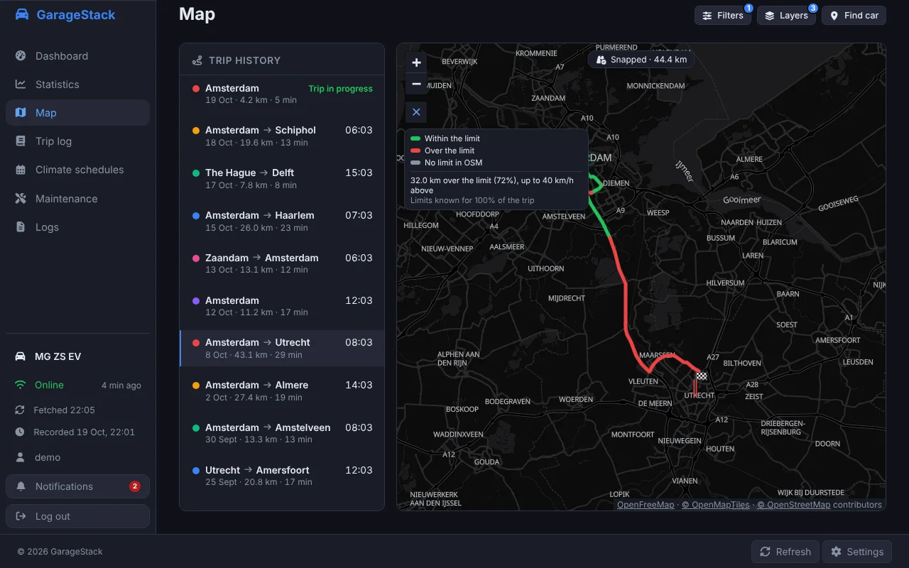

### Statistics

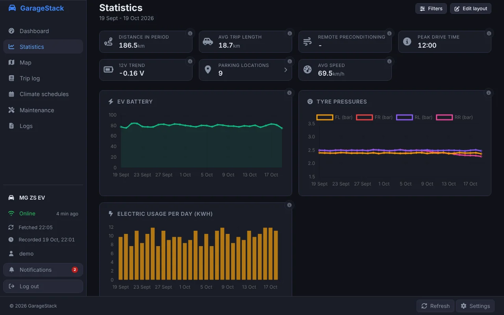

### Trip log

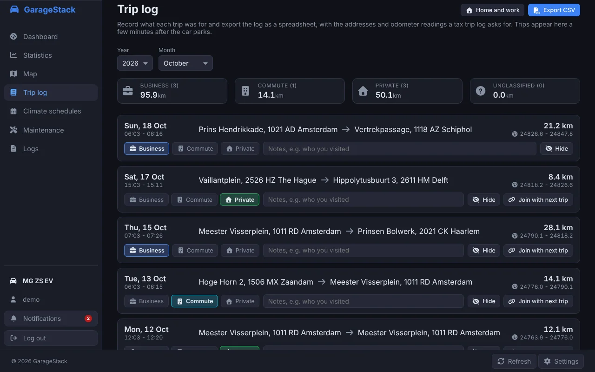

### Maintenance

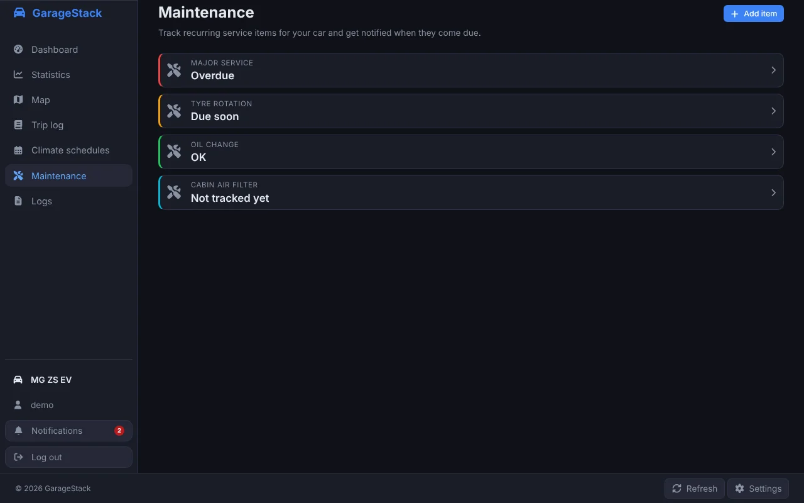

### Climate schedules

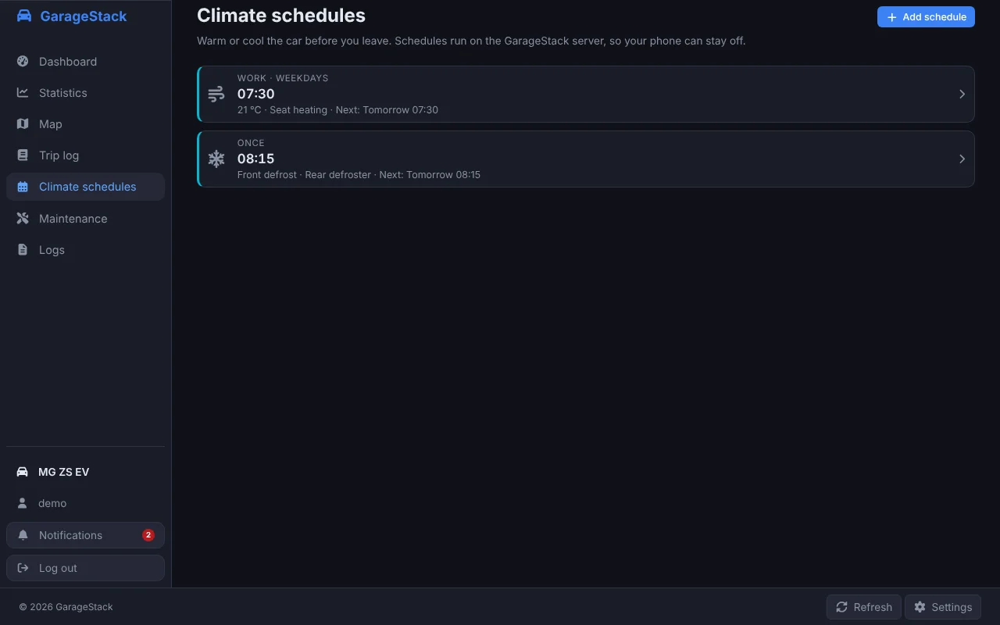

### Light theme

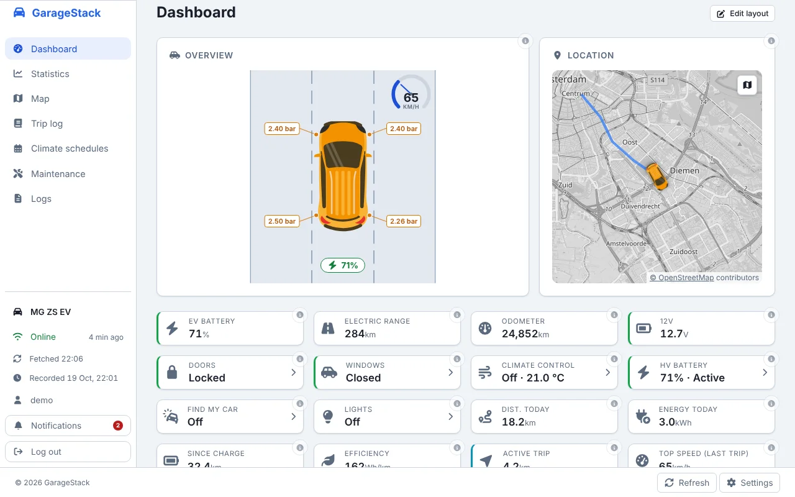

## Phone

<!-- markdownlint-disable MD033 -->

| Dashboard | Map | A single trip | Light theme |
| --------- | --- | ------------- | ----------- |
|  |  |  | 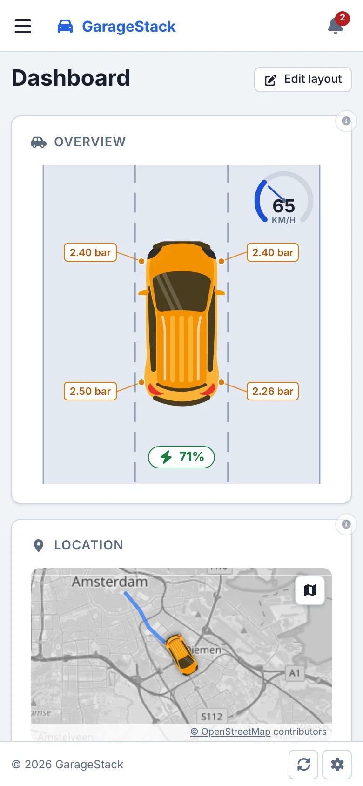 |
| **Statistics** | **Trip log** | **Maintenance** | **Climate schedules** |
| 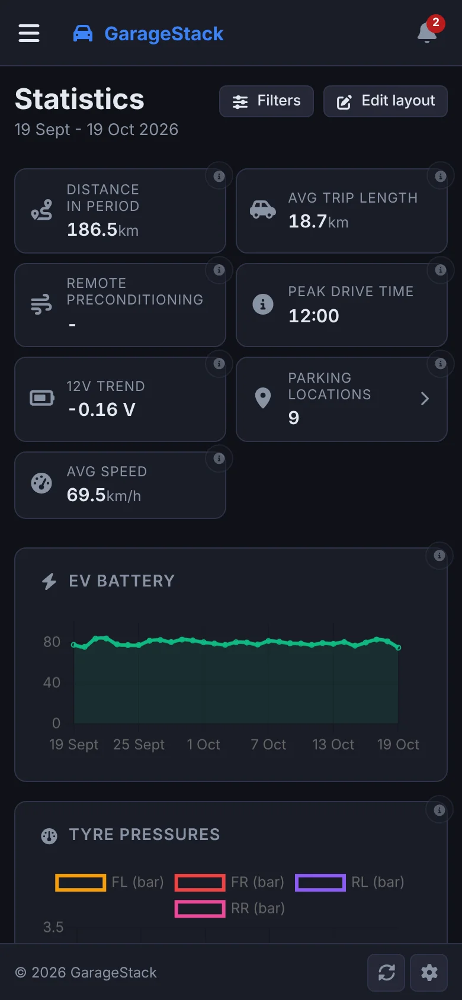 | 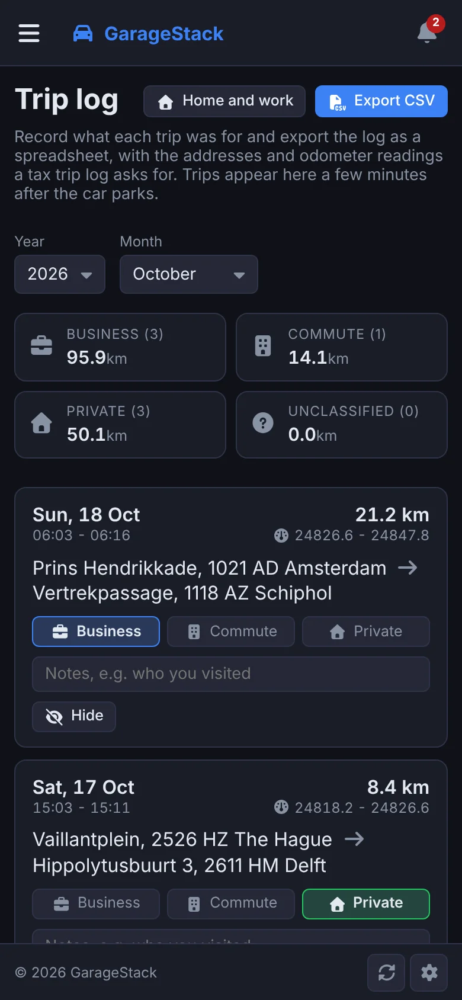 | 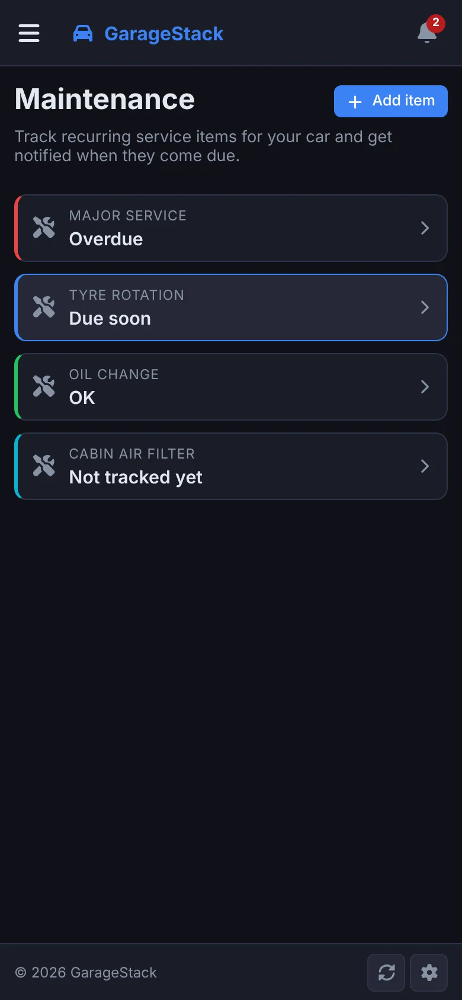 | 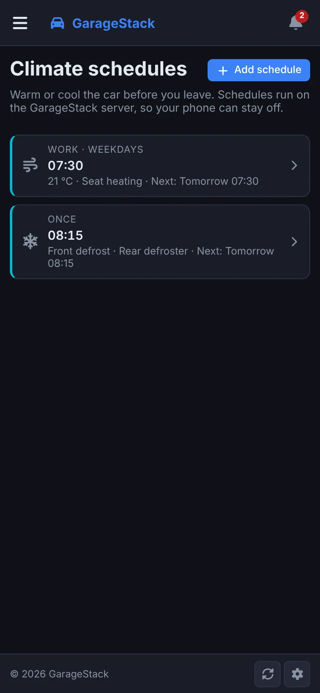 |

<!-- markdownlint-enable MD033 -->

## Taking new ones

`pnpm screenshots` in `frontend/` takes all of them again from a running demo stack, and copies the dashboard, map and statistics ones to the install screenshots in the app's manifest (`frontend/public/screenshot-*.webp`):

```bash
cp .env.demo.example .env.demo
docker compose --env-file .env.demo -f docker-compose.demo.yml up -d --build   # repository root
cd frontend && pnpm screenshots                                                 # or: pnpm screenshots http://localhost:5173
```

It signs in as `demo`, and takes the desktop screenshots at 1280 x 800 and the phone screenshots at 390 x 844 at twice the pixel density, in the dark theme with the date filter on 30 days and the region set to the Netherlands, plus the dashboard in the light theme. The maps need the internet for their tiles; behind a proxy, `HTTPS_PROXY` is used for them. `CHROMIUM_PATH` points it at a Chromium other than Playwright's own. Keep the manifest's `sizes` in `frontend/vite.config.ts` in step if the sizes change.
